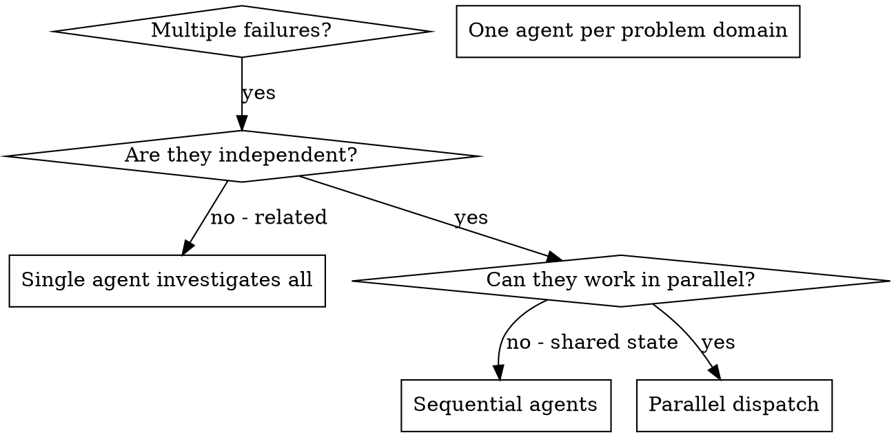

# Dispatching Parallel Agents

## Overview

When you have multiple unrelated failures (different test files, different subsystems, different bugs), investigating them sequentially wastes time. Each investigation is independent and can happen in parallel.

**Core principle:**
<!-- hive-host opencode-v1 -->
Dispatch one primary goal per native `task()` invocation and expect one terminal report.
<!-- /hive-host -->
<!-- hive-host opencode-v2 -->
Dispatch one primary goal per native `subagent()` invocation and expect one terminal report.
<!-- /hive-host -->
Every returned result is terminal, so every follow-up uses a fresh child session and may reuse the same Hive task/worktree. Review findings are fresh assignments in the same implementation lane.
<!-- hive-host opencode-v1 -->
Primaries must not pass `task_id` or infer continuation eligibility from task output, trace, board state, cancellation acknowledgement, or transcript quality.
<!-- /hive-host -->
<!-- hive-host opencode-v2 -->
Primaries must not pass `sessionID` or infer continuation eligibility from task output, trace, board state, cancellation acknowledgement, or transcript quality.
<!-- /hive-host -->
<!-- hive-host opencode-v1 -->
Pass `task_id` only when explicit operator instruction or runtime-owned interruption recovery authorizes continuation; otherwise launch fresh.
<!-- /hive-host -->
<!-- hive-host opencode-v2 -->
Pass `sessionID` only when explicit operator instruction or runtime-owned interruption recovery authorizes continuation; otherwise launch fresh.
<!-- /hive-host -->
If the child may still be active or its lifecycle is uncertain, inspect, wait, or reattach as supported; do not send another prompt or launch an overlapping writer. Compaction re-anchoring of a currently running worker is distinct from follow-up work. Trace recovery is untrusted and cannot authorize continuation. Parallel writes require disjoint registered worktrees (separate tasks or distinct ad-hoc runIds). Multiple writes in the same worktree must run sequentially.

### Worktree Concurrency & Sequencing
- **One writer per worktree:** A single worktree has exactly one active writer at a time.
- **Parallel writes across worktrees:** You can dispatch writing workers in parallel ONLY if each worker runs in its own distinct worktree (distinct feature tasks or distinct ad-hoc `runId`s).
- **Sequential passes within a worktree:** If multiple tasks or bug fixes target the SAME worktree, sequence them: create or reuse the worktree -> dispatch the native call -> wait for completion -> record status -> next pass.
- **Destination checkpoints:** Put the primary-owned inspected destination path/ref/commit in every writing handoff. Long workers check it at coherent committed milestones and terminal return. Relevant or uncertain drift returns control to the primary for same-worktree reconciliation; it does not trigger an overlapping replacement writer.
- **Read-only fan-out:** Scouts and reviewers do not write code and can run concurrently anywhere.

Read [references/launch-examples.md](references/launch-examples.md) when you write your first launch of a session and want complete calls, need the ad-hoc placement check before `hive_adhoc_worktree_create`, or write an assignment prompt.

When `## Background-First Orchestration` is present, load `background-delegation` for scheduler and wait-mode decisions. This skill covers task independence, scope, and prompt quality; the background skill governs whether each independent lane runs blocking or background.

## Workflow Mode

In feature-task mode, use the prerequisites below. In Hive Builder or unified Hive ad-hoc mode, load `orchestrating-ad-hoc-work`; that skill owns decomposition, the lane inventory, dependency waves, resource ownership, and integration order. This skill retains only common fan-out mechanics, the one-goal contract, and one-writer/worktree rules.

## Feature-Task Sequencing

In feature-task mode, use `hive_status()` for dependencies and the runnable list; follow the primary prompt's freshness procedure before dispatch. Dependencies guide sequencing; they are not a dispatch admission gate. Sync and manual creation reject invalid dependencies of unfinished tasks; done and cancelled tasks' dependencies are history. Only `done` satisfies a dependency, so a task that depends on a cancelled task stays blocked until the operator decides how to replace it.

When the operator gives an explicit direction (parallel, sequential, or a subset), follow it. Otherwise sequence from dependencies and disjoint worktrees. Record the reasoning behind chosen sequencing in `execution-decisions` when it will matter later; the milestone itself belongs in the Worklog.

When direction is run/continue a feature until a target task is complete/done, load `executing-plans` and apply Target Task Milestones before fan-out. Explicit companion suffixes use the same procedure. Its current-status combined prerequisite closure bounds eligible work; this skill's independence and ownership checks still govern dispatch within that scope.

## When to Use

**Use when:**
- Independently diagnosable failures with different root causes
- Multiple subsystems broken independently
- Each problem can be understood without context from others
- No shared state between investigations

**Don't use when:**
- Failures are related (fix one might fix others) or need full system state to understand
- You don't yet know what is broken (exploratory debugging)
- Agents would interfere with each other: editing the same files or using the same resources

## The Pattern

### 1. Identify Independent Domains

Group failures by what's broken:
- File A tests: Tool approval flow
- File B tests: Batch completion behavior
- File C tests: Abort functionality

Each domain is independent - fixing tool approval doesn't affect abort tests.

In ad-hoc mode, do not use this step to define lane boundaries. Consume the ready wave from `orchestrating-ad-hoc-work`.

### 2. Create Focused Agent Tasks

Each agent gets:
- **Specific scope:** One primary goal, which may include tightly coupled code, tests, docs, and multiple files
- **Clear goal:** Make these tests pass
- **Constraints:** Don't change other code
- **Expected output:** Summary of what you found and fixed

Apply the native task contract above to every launch. Give complete constraints and acceptance criteria only for that goal. Each prompt is a context packet: objective and done criteria, known findings and file or reference pointers, prior failures or attempts, constraints, non-goals, ownership boundaries, expected output, verification or return requirements, and how to find missing context. Point at catalog names and IDs rather than pasting every context body.
<!-- hive-host opencode-v1 -->
Put the complete Forager packet directly in the unchanged native `task.prompt`; ordinary Scout, advisor, and reviewer packets also go in `task.prompt`. Returned task IDs are also observe-only board handles for status, reconcile, and cancel.
<!-- /hive-host -->
<!-- hive-host opencode-v2 -->
Put the complete Forager packet directly in the unchanged native `subagent.prompt`; ordinary Scout, advisor, and reviewer packets also go in `subagent.prompt`. `hive_background_status` lists the observe-only board handle for status, reconcile, and cancel.
<!-- /hive-host -->
At dispatch, the runtime appends a route snapshot (project root and selected feature) plus session and feature constraints.

In feature-task mode, one implementation assignment normally maps to one numbered task; an independently verifiable new deliverable requires a DAG amendment or append-only manual task. In ad-hoc mode, use multiple fresh one-goal launches with disjoint path ownership or sequence overlapping writers.

### 3. Dispatch in Parallel

In feature-task mode, create each Forager worktree with `hive_worktree_create`, passing the feature explicitly, and capture the destination from its inspection-shaped result; later checkpoints remain required. Start each assignment's first non-empty line with `Hive task: <task-folder>`. Independent Forager worktrees may be created and dispatched under one parent. In ad-hoc mode, consume the ready wave from `orchestrating-ad-hoc-work`.

Gate-open sessions may add `background: true` when independent foreground work can continue; the blocking alternative serves every gate-closed session.
<!-- hive-host opencode-v1 -->
Before native `task()` dispatch, call `hive_feature_select` only when the selected route is unset or differs from the dispatch target, or the selection evidence below is missing or uncertain.
<!-- /hive-host -->
<!-- hive-host opencode-v2 -->
Before native `subagent()` dispatch, call `hive_feature_select` only when the selected route is unset or differs from the dispatch target, or the selection evidence below is missing or uncertain.
<!-- /hive-host -->
Reuse a matching selection across a same-feature batch only when this session's most recent route-changing call visible in context is `hive_feature_select` for that same feature, with no later explicit-null or other-feature selection. When that evidence is not visible (for example after compaction or a summary, at session start, or in mixed ad-hoc/feature batches), or you are uncertain, call `hive_feature_select` for the dispatch target. Explicit null suppresses fallback and stays featureless unless the dispatch intentionally targets a feature.
<!-- hive-host opencode-v1 -->
For ad-hoc work, call `hive_adhoc_worktree_create`, then issue the next native `task()` call unchanged with a Forager or Forager-derived agent.
<!-- /hive-host -->
<!-- hive-host opencode-v2 -->
For ad-hoc work, call `hive_adhoc_worktree_create`, then issue the next native `subagent()` call unchanged with a Forager or Forager-derived agent.
<!-- /hive-host -->
Batch independent Hive calls in one response/step, while sequencing dependent calls and mutations sharing a destination or state register. Treat installs, builds, formatters, generators, and tests as mutations. Distinct worktrees do not isolate fixed-path fixtures, ports, databases, containers, generated outputs, or external mutable resources; consume the owning workflow's resource sequencing. Ordinary Scout, advisor, and reviewer launches remain eligible for same-message parallel dispatch.

In feature-task mode, follow the primary prompt's binding and assignment rules. Keep the worker's successor handoff; when a terminal report names accepted Forward obligations, follow the primary prompt's post-merge promotion procedure before recipient dispatch.

Use Forager-derived workers for delegated execution.
<!-- hive-host opencode-v1 -->
A rare native `general` exception is an ordinary `task()` call with ordinary tools only: no Hive authority, recursion, or questions.
<!-- /hive-host -->
<!-- hive-host opencode-v2 -->
A rare native `general` exception is an ordinary `subagent()` call with ordinary tools only: no Hive authority, recursion, or questions.
<!-- /hive-host -->
Native helpers keep only their bounded operational permissions. Unknown targets remain denied. Hive's bounded Architect planning lane remains available. Direct checkout work is unmanaged OpenCode work, not a Hive worktree.

See `background-delegation` for board recovery.
For read-only research, use `parallel-exploration`; this skill owns writing/change and execution dispatch.

Choose the best-fit available descriptor for the requested output. Scout is for bounded source retrieval, not causal diagnosis or solution selection. A Forager diagnosis-only lane reports evidence, hypotheses tested and untested, a supported conclusion or unresolved status, and options when asked; it must not author fixes or other implementation changes, modify the original source under diagnosis, commit, or perform destructive reproduction unless the mission separately authorizes implementation in appropriate isolation. Scratch scripts, fixtures, builds, local servers, browser sessions, and a disposable copy of the submitted candidate that the mission names are not implementation; the lane keeps its evidence, stops what it started, and removes only the temporary reproduction artifacts it created.

### 4. Review and Integrate

When agents return:
- Read each summary
- Verify fixes don't conflict
- In feature-task mode, pass each returned topology-aware pin unchanged through the feature workflow's verification and primary-owned `hive_worktree_merge` lifecycle with the unchanged inspected target expectation. Use same-call `cleanup: 'worktree+branch'` when retention is not needed. Use the complete map when persisted `repos` are present; a singleton composite scalar is accepted, while multiple repositories require the complete map.
- In ad-hoc mode, return result state and its exact pin to `orchestrating-ad-hoc-work`, which owns review gates, deterministic integration, selected integrated acceptance, and `hive_adhoc_worktree_merge`.

## Agent Prompt Structure

Good agent prompts are:
1. **Focused** - One clear problem domain
2. **Self-contained** - All context needed to understand the problem, as pointers and known facts, not a dump of every note
3. **Specific about output** - What should the agent return?

The reference has a worked prompt and the contrasts between weak and strong versions.

## Method selection

A deterministic lever can beat fan-out. Prefer an existing codemod, script, or check when it can safely process the units together. Build a rerunnable transformation when repetition or reviewability warrants it; do not require a new script for every nontrivial task. The placement policy still governs who writes and runs it.

For an explicitly requested race, state the selection rule before dispatch, isolate writable outputs, and report dropouts as gaps. Coverage work partitions evidence or ownership; competing solutions compare the same brief. Neither requires a fixed worker count.

## Verification by Mode

In feature-task mode, follow binding repository/operator checks and the plan's task and final-verification gates. Keep required early and pre-merge checks at their approved boundary, and resolve each named integrated deferral against its `## Final Verification` owner and prerequisite. In ad-hoc mode, return result and resource state to `orchestrating-ad-hoc-work`; it owns per-lane gates and selected integrated acceptance after the accepted batch is merged.
